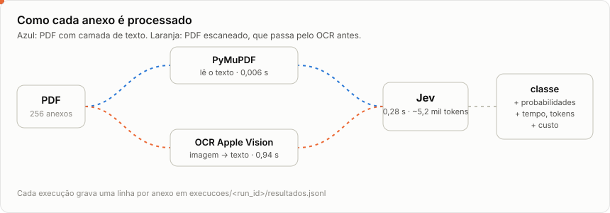
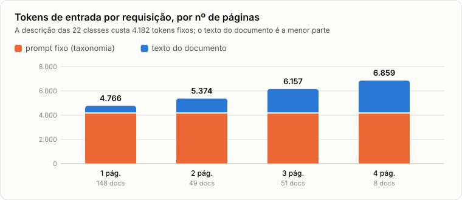

# Classificação de anexos jurídicos com o Jev

Experimento para testar se o **Jev**, modelo da [TypeSafe](https://docs.typesafe.ai), consegue dizer que tipo de peça é cada anexo de um processo judicial: petição inicial, contestação, sentença, certidão, procuração e outros, em 21 classes. O experimento também mede quanto tempo e quanto dinheiro isso custa por documento.

Diferente de um LLM de chat, o Jev não escreve uma resposta: ele devolve uma distribuição de probabilidade sobre as classes. A seção [Como o Jev funciona](#como-o-jev-funciona) explica por que isso importa.

<p align="center">
  
</p>

## Como o Jev funciona

O Jev é um modelo "System One" da TypeSafe: em vez de gerar texto, ele dá **julgamentos rápidos e tipados** que o código consome direto. Cada requisição leva duas coisas:

- **`state`:** o contexto a ser julgado. Aqui é o texto do anexo, o número de páginas e se o texto veio de OCR.
- **`questions`:** as perguntas. Aqui é uma só, do tipo `Choice` (escolha entre opções). As instruções dizem o que fazer ("classifique pelo que o documento é, não pelo que ele cita") e cada uma das 22 opções vem com uma descrição: o que é, sinais típicos e com o que não confundir. Tudo isso está em [`taxonomia.py`](taxonomia.py).

```python
resposta = await cliente.system_one(
    state={"documento": {"texto": texto, "paginas": 1, "origem_texto": "OCR (pode conter erros)"}},
    questions={"tipo": Choice(instructions=INSTRUCOES, criteria=CLASSES)},
)
```

A resposta não é uma frase: é uma **distribuição de probabilidade** sobre as 22 opções. A animação mostra dois anexos reais do teste. Antes de ler, todas as opções têm a mesma chance; depois a probabilidade se concentra, e a confiança decide se o anexo é classificado sozinho ou vai para uma pessoa.

<p align="center">
  
</p>

A resposta crua da API para o despacho `doc_0023`, o caso mais difícil do teste:

```json
{
  "model": "jev-1.13.0",
  "usage": { "input_tokens": 4450, "output_tokens": 232 },
  "answers": {
    "tipo": {
      "type": "choice",
      "choice": "despacho",
      "confidence": 0.85,
      "probabilities": {
        "despacho": 0.86,
        "certidao": 0.14,
        "decisao_interlocutoria": 0.0,
        "...": "as outras 19 opções com 0.0"
      }
    }
  }
}
```

| Campo | O que é | Como o experimento usa |
|---|---|---|
| `choice` | A opção mais provável | Classe atribuída ao anexo |
| `probabilities` | Probabilidade de cada opção; soma 1 | Gravada inteira no `resultados.jsonl`; mostra qual era a segunda opção e por quanto |
| `confidence` | 0 a 1, quão concentrada está a distribuição: um pico só dá perto de 1, probabilidade espalhada dá valor baixo | Critério para mandar o anexo à revisão humana |
| `usage` | Tokens consumidos | Cálculo do custo |

**Por que isso importa:**

- **Não tem resposta para interpretar.** A classe sempre é uma das 22 opções definidas, sem texto livre, sem formato quebrado e sem classe inventada.
- **A dúvida vem em número.** No `doc_0023`, o Jev disse "despacho, mas com 14% de chance de ser certidão". Essa é justamente a confusão esperada, porque certidões de publicação reproduzem o texto do despacho. O código pode usar isso direto: acima de um corte, classifica sozinho; abaixo, manda para uma pessoa.
- **A probabilidade é reaproveitável.** Mudar o corte de confiança, juntar classes (por exemplo, todos os recursos) ou montar um ranking não exige nova chamada ao Jev; basta reprocessar as probabilidades já gravadas.
- **É rápido e barato.** A saída é curta e não é cobrada (só a entrada custa US$ 0,042 por milhão de tokens), daí os 0,28 s e US$ 0,0002 por anexo.

O Jev também tem outros dois tipos de pergunta, não usados aqui: `Noul`, que dá a probabilidade de algo ser verdade ("este anexo tem pedido de tutela de urgência?"), e `Score`, que dá uma nota numa escala definida. Várias perguntas sobre o mesmo documento podem ir na mesma requisição e são respondidas em paralelo.

> A probabilidade é a estimativa do modelo, não uma garantia. A TypeSafe treina o Jev para ser calibrado, mas o corte de confiança certo para produção precisa ser medido com documentos reais rotulados.

## Resultado em uma frase

**O Jev acertou os 256 anexos de teste (100%), em 0,28 s por documento e a US$ 0,22 por mil documentos.** Os anexos são sintéticos, então esse número é um teto otimista; [veja as limitações](#limitações).

| | |
|---|---|
| Anexos classificados | 256 (21 classes; 65 escaneados, 48 deles lidos por OCR local) |
| Acerto | **256 / 256** |
| Confiança média | 0,997 (240 documentos com confiança 1,00) |
| Tempo do Jev por documento | 0,28 s em média, 0,32 s no p95, 0,46 s no pior caso |
| Tempo total, de PDF a classe | 62 s para os 256 (53 s de OCR, 9 s de Jev) |
| Tokens por documento | 5.225 em média (entre 4.380 e 7.303) |
| Custo total do Jev | **US$ 0,056** pelos 256 |
| Erros de API | 0 |

Execução de referência: `execucoes/20261016-115220-5eb5`, modelo `jev-1.13.0`, 8 requisições simultâneas, `prompt_hash c4ffefc2e54f`.

## O conjunto de teste

São 256 PDFs fictícios em `anexos_juridicos_teste/pdfs/`, com gabarito em `manifest.csv`. Eles foram feitos para atrapalhar:

- **65 são escaneados:** 47 não têm texto nenhum (aqui passaram por OCR local) e 18 já trazem uma camada de OCR com erros, usada como está. Há inclinação, manchas, furos de perfurador e toner falhado.
- **Carimbos de sistema** (e-SAJ, PJe, PJe-JT, Projudi) aparecem em todas as páginas.
- **Pares confundíveis de propósito:**
  - acórdão que transcreve a sentença;
  - certidão de publicação que traz o texto de um despacho;
  - ata de audiência com acordo × termo de acordo × sentença homologatória;
  - decisão × despacho sem título;
  - ofício escrito pelo banco.
- **Três justiças:** estadual cível (127), juizado especial (75) e trabalho (54).

## Gráficos

### Onde está o tempo


O Jev é rápido e previsível: 0,27 s com ou sem OCR, e a variação entre documentos é pequena. O gargalo é ler o PDF escaneado. O OCR local (Apple Vision) leva 0,94 s por documento na mediana e 3,6 s no pior caso. Num PDF com texto, a leitura custa 6 milissegundos.

### Onde estão os tokens (e o custo)



Cerca de **80% dos tokens são a descrição das classes**, que vai em toda requisição. A explicação de cada classe, com o que é, sinais típicos e com o que não confundir, ocupa 4.182 tokens. Um anexo de uma página acrescenta só uns 600. Isso significa que:

- o custo quase não depende do tamanho do documento (uma página custa US$ 0,0002, quatro páginas custam US$ 0,0003);
- encurtar a taxonomia seria a principal alavanca de custo. Ela não vale a pena hoje, porque o custo já é baixo e as descrições detalhadas provavelmente ajudam no acerto.

### Onde o Jev hesitou


Mesmo nos casos mais difíceis a classe certa ficou com pelo menos 86% da probabilidade. As dúvidas aparecem exatamente nos pares em que um advogado também pararia para pensar:

- **despacho × decisão interlocutória:** a diferença é se o juiz decide uma questão ou só dá andamento;
- **despacho × certidão:** o servidor certifica a publicação de um despacho;
- **decisão monocrática do relator × agravo de instrumento:** a decisão é sobre o agravo.

### Confiança por recorte

| Recorte | Docs | Acerto | Confiança média |
|---|---:|---:|---:|
| PDF com texto | 191 | 100% | 0,998 |
| Escaneado sem texto (OCR local) | 47 | 100% | 0,996 |
| Escaneado com OCR antigo cheio de erros | 18 | 100% | 0,996 |
| Ruído visual nível 2–3 | 30 | 100% | 0,993 |
| Justiça estadual cível | 127 | 100% | 0,996 |
| Juizado especial cível | 75 | 100% | 0,998 |
| Justiça do trabalho | 54 | 100% | 0,999 |
| Sem documentos do Projudi¹ | 233 | 100% | 0,997 |

¹ O cabeçalho do Projudi às vezes traz o próprio tipo do documento no nome do arquivo. Tirando esses casos, o resultado não muda, então o Jev não estava se apoiando nessa pista.

<details>
<summary>Confiança por classe (21 classes)</summary>

| Classe | Docs | Confiança mínima | Confiança média |
|---|---:|---:|---:|
| despacho | 19 | 0,85 | 0,990 |
| decisao_interlocutoria | 21 | 0,90 | 0,980 |
| ata_audiencia | 12 | 0,98 | 0,998 |
| certidao | 26 | 0,99 | 1,000 |
| oficio | 11 | 0,99 | 0,999 |
| calculos_liquidacao | 7 | 0,99 | 0,999 |
| demais 15 classes | 160 | 1,00 | 1,000 |

</details>

## Como seria em produção: 300 mil anexos por mês

Projeção feita a partir das médias medidas neste experimento: 1,68 página por anexo, 19% dos anexos precisando de OCR e 5.225 tokens por requisição. O volume real tem outra mistura de documentos, então trate como ordem de grandeza.


| Para 300 mil anexos/mês | Estimativa |
|---|---|
| Por dia | ~10 mil anexos (~14 mil em dias úteis) |
| Páginas | ~505 mil, das quais ~71 mil precisam de OCR |
| Tokens no Jev | ~1,57 bilhão |
| **Custo do Jev** | **~US$ 66/mês** (US$ 790/ano) |
| OCR em nuvem, se usado² | ~US$ 107/mês |
| OCR local (Tesseract, Apple Vision) | só o custo da máquina: ~17 h de CPU/mês num Mac, ~35 min/dia |
| Tempo de Jev | ~3 h/mês com 8 requisições simultâneas; ~6 min para o lote de um dia |
| Latência por anexo | ~0,3 s com texto, ~1,2 s escaneado |
| Fila para revisão humana³ | ~4.700/mês com corte em 0,95; ~1.200/mês com corte em 0,90 |

² Preço de referência de OCR gerenciado (Amazon Textract, Google Document AI) na faixa de US$ 1,50 por mil páginas. Confira o preço do provedor escolhido.
³ No experimento, 4 de 256 documentos ficaram abaixo de 0,95 de confiança e 1 abaixo de 0,90. Em documentos reais essa proporção tende a ser maior; o corte deve ser calibrado com uma amostra real rotulada.

**O que isso mostra:**

- **O Jev não é o custo relevante.** US$ 66 por mês para 300 mil anexos é menos que o OCR em nuvem. O que pesa é ler PDFs escaneados.
- **Volume não é problema.** O lote de um dia inteiro passa pelo Jev em minutos. Os limites de requisição da TypeSafe não são publicados; com 8 requisições simultâneas não houve nenhum erro.
- **Arquitetura sugerida:**
  - fila de anexos;
  - extração (texto direto ou OCR);
  - Jev;
  - regra de confiança: acima do corte, classifica automaticamente; abaixo, vai para revisão humana ou para um modelo de raciocínio;
  - gravação do registro por anexo, como já é feito em `resultados.jsonl`, para acompanhar acerto, custo e latência ao longo do tempo.

## Limitações

- **Os dados são sintéticos.** Os textos foram montados a partir de blocos por tipo de peça. Documentos reais têm mais variedade, peças híbridas, anexos fora da taxonomia e PDFs muito maiores. O próximo passo natural é rotular algumas centenas de anexos reais e rodar o mesmo script.
- **O custo é calculado, não faturado.** A API devolve os tokens consumidos; o valor em dólar usa o preço público (US$ 0,042 por milhão de tokens de entrada; a saída é gratuita). Confira na fatura da TypeSafe.
- **O OCR é local e depende de macOS.** O Apple Vision só roda em Mac; em servidor Linux seria preciso trocar por Tesseract ou um serviço em nuvem.
- **Há um limite de tamanho.** O Jev aceita até 32 mil tokens por pergunta. Documentos com mais de 60 mil caracteres são cortados, mantendo o início e o fim. Nenhum anexo deste conjunto chegou perto disso.
- **Só um modelo foi testado.** Tudo aqui é do `jev-1.13.0`. O `jev-preview` (Jev 1.14) pode ser testado com `--modelo jev-preview`.

## Como rodar

```bash
python3.12 -m venv .venv            # ou: uv venv --python 3.12 .venv
.venv/bin/pip install -r requirements.txt
echo "TYPESAFE_API_KEY=..." > .env

# classificar (com gabarito para medir acerto)
.venv/bin/python classificar.py anexos_juridicos_teste/pdfs \
    --gabarito anexos_juridicos_teste/manifest.csv --rotulo "minha execução"

# regenerar os gráficos a partir de uma execução
.venv/bin/python relatorio/gerar_graficos.py execucoes/<run_id>
```

Opções úteis de `classificar.py`:

- `--limite N` classifica só os N primeiros PDFs;
- `--modelo jev-preview` troca o modelo;
- `--concorrencia 16` muda o número de requisições simultâneas;
- `--sem-cache` refaz o OCR.

## Estrutura

| Arquivo | O que faz |
|---|---|
| `taxonomia.py` | A pergunta e as 22 opções enviadas ao Jev (21 classes + `outro`), cada uma com o que é, sinais e com o que não confundir. Alterar o arquivo muda o `prompt_hash` gravado nas execuções. |
| `extracao.py` | Lê o texto do PDF com PyMuPDF; páginas sem texto passam por OCR (Apple Vision). Guarda o texto em `cache_texto/`. |
| `classificar.py` | Roda tudo e grava `execucoes/<run_id>/resultados.jsonl` (uma linha por anexo) e `resumo.json` (totais). |
| `relatorio/gerar_graficos.py` | Gera os SVGs de `docs/graficos/` a partir de uma execução. |
| `anexos_juridicos_teste/` | PDFs de teste, gabarito e o gerador que os criou. O classificador foi escrito sem consultar o gerador. |

Cada linha de `resultados.jsonl` traz:

- a classe, a confiança e a probabilidade de todas as classes;
- os tempos de extração e do Jev;
- os tokens, o custo, o modelo e o `request_id`;
- quando há gabarito: o rótulo esperado, se acertou, subtipo, nível de ruído, tipo de carimbo e camada de texto.
