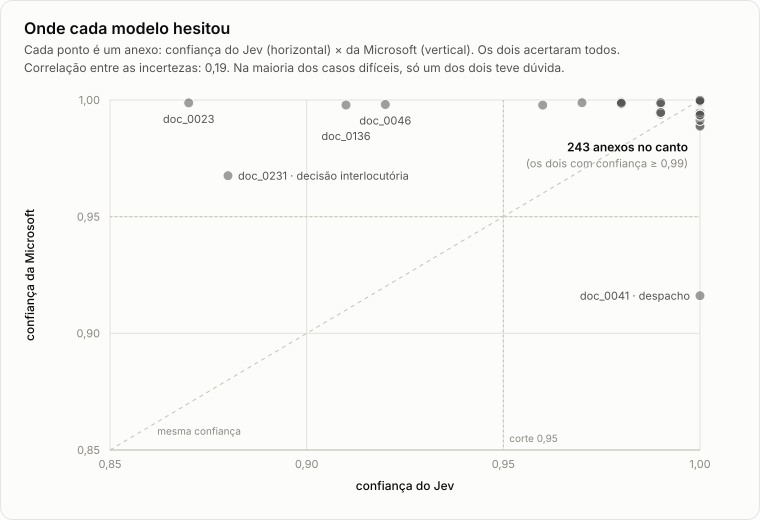
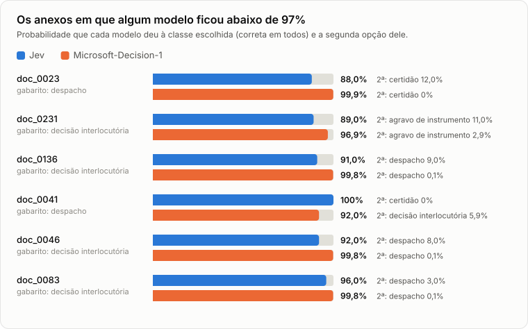
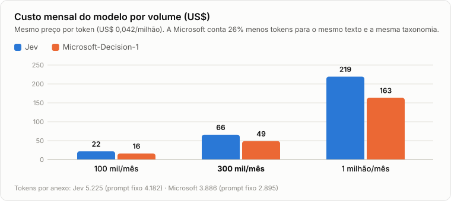
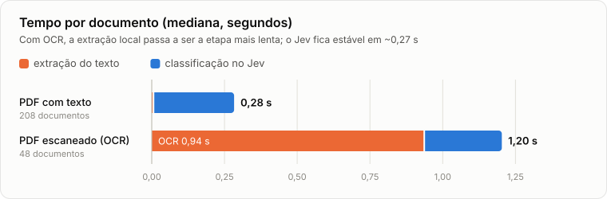
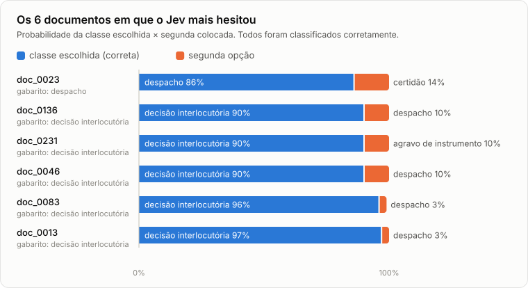
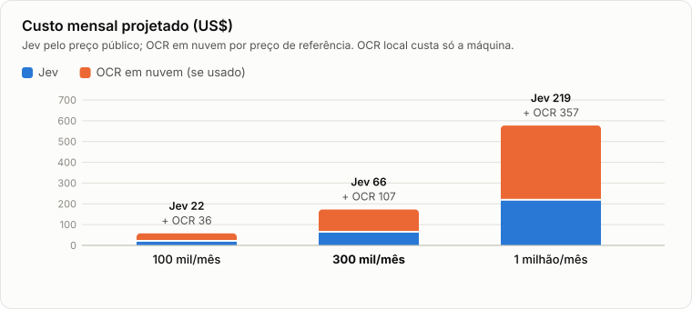

# Classificação de anexos jurídicos: Jev × Microsoft-Decision-1

Experimento para testar se modelos de decisão conseguem dizer que tipo de peça é cada anexo de um processo judicial: petição inicial, contestação, sentença, certidão, procuração e outros, em 21 classes. O experimento também mede quanto tempo e quanto dinheiro isso custa por documento.

Dois modelos foram testados com **a mesma pergunta e o mesmo texto**:

- **Jev**, da [TypeSafe](https://docs.typesafe.ai), chamado direto na API da TypeSafe;
- **Microsoft-Decision-1**, da Microsoft, chamado pelo [OpenRouter](https://openrouter.ai/microsoft/microsoft-decision-1) e servido pela Azure. Por isso os tempos medidos para ele incluem o OpenRouter no caminho ([veja o aviso](#jev--microsoft-decision-1)).

Diferente de um LLM de chat, nenhum dos dois escreve uma resposta: eles devolvem uma distribuição de probabilidade sobre as classes. A seção [Como o Jev funciona](#como-o-jev-funciona) explica por que isso importa, e [Jev × Microsoft-Decision-1](#jev--microsoft-decision-1) compara os dois.

<p align="center">
  
</p>

## Como o Jev funciona

O Jev é um modelo "System One" da TypeSafe: em vez de gerar texto, ele dá **julgamentos rápidos e tipados** que o código consome direto. Cada requisição leva duas coisas:

- **`state`:** o contexto a ser julgado. Aqui é o texto do anexo, o número de páginas e se o texto veio de OCR.
- **`questions`:** as perguntas. Aqui é uma só, do tipo `Choice` (escolha entre opções). As instruções dizem o que fazer ("classifique pelo que o documento é, não pelo que ele cita") e cada uma das 22 opções vem com uma descrição: o que é, sinais típicos e com o que não confundir. Tudo isso está em [`taxonomia.py`](taxonomia.py).

```python
resposta = await cliente.system_one(
    state={"documento": {"texto": texto, "paginas": 1, "origem_texto": "OCR (pode conter erros)"}},
    questions={"tipo": Choice(instructions=INSTRUCOES, criteria=CLASSES)},
)
```

A resposta não é uma frase: é uma **distribuição de probabilidade** sobre as 22 opções. A animação mostra dois anexos reais do teste. Antes de ler, todas as opções têm a mesma chance; depois a probabilidade se concentra, e a confiança decide se o anexo é classificado sozinho ou vai para uma pessoa.

<p align="center">
  
</p>

A resposta crua da API para o despacho `doc_0023`, o caso mais difícil do teste:

```json
{
  "model": "jev-1.13.0",
  "usage": { "input_tokens": 4450, "output_tokens": 232 },
  "answers": {
    "tipo": {
      "type": "choice",
      "choice": "despacho",
      "confidence": 0.85,
      "probabilities": {
        "despacho": 0.86,
        "certidao": 0.14,
        "decisao_interlocutoria": 0.0,
        "...": "as outras 19 opções com 0.0"
      }
    }
  }
}
```

| Campo | O que é | Como o experimento usa |
|---|---|---|
| `choice` | A opção mais provável | Classe atribuída ao anexo |
| `probabilities` | Probabilidade de cada opção; soma 1 | Gravada inteira no `resultados.jsonl`; mostra qual era a segunda opção e por quanto |
| `confidence` | 0 a 1, quão concentrada está a distribuição: um pico só dá perto de 1, probabilidade espalhada dá valor baixo | Critério para mandar o anexo à revisão humana |
| `usage` | Tokens consumidos | Cálculo do custo |

**Por que isso importa:**

- **Não tem resposta para interpretar.** A classe sempre é uma das 22 opções definidas, sem texto livre, sem formato quebrado e sem classe inventada.
- **A dúvida vem em número.** No `doc_0023`, o Jev disse "despacho, mas com 14% de chance de ser certidão". Essa é justamente a confusão esperada, porque certidões de publicação reproduzem o texto do despacho. O código pode usar isso direto: acima de um corte, classifica sozinho; abaixo, manda para uma pessoa.
- **A probabilidade é reaproveitável.** Mudar o corte de confiança, juntar classes (por exemplo, todos os recursos) ou montar um ranking não exige nova chamada ao Jev; basta reprocessar as probabilidades já gravadas.
- **É rápido e barato.** A saída é curta e não é cobrada (só a entrada custa US$ 0,042 por milhão de tokens), daí os 0,28 s e US$ 0,0002 por anexo.

O Jev também tem outros dois tipos de pergunta, não usados aqui: `Noul`, que dá a probabilidade de algo ser verdade ("este anexo tem pedido de tutela de urgência?"), e `Score`, que dá uma nota numa escala definida. Várias perguntas sobre o mesmo documento podem ir na mesma requisição e são respondidas em paralelo.

> A probabilidade é a estimativa do modelo, não uma garantia. A TypeSafe treina o Jev para ser calibrado, mas o corte de confiança certo para produção precisa ser medido com documentos reais rotulados.

### E o Microsoft-Decision-1?

Ele fala a mesma língua: recebe `state` e `questions` no mesmo formato e devolve `choice`, `probabilities` e `confidence`. Por isso o experimento manda **exatamente o mesmo `Choice`**, com as mesmas instruções e as mesmas 22 descrições de [`taxonomia.py`](taxonomia.py), e o mesmo texto já extraído dos PDFs. A diferença está só no endereço: a chamada vai para o endpoint de decisões do OpenRouter, que ainda está em versão alfa. A Microsoft também oferece o modelo direto na Azure AI Foundry (`<recurso>/providers/microsoft/v1/systemone`), sem intermediário. Este experimento ainda não usou esse caminho, e isso afeta a medição de tempo ([veja o aviso](#jev--microsoft-decision-1)).

```python
resposta = await cliente.post("https://openrouter.ai/api/alpha/decisions", json={
    "model": "microsoft/microsoft-decision-1",
    "state": {"documento": {"texto": texto, "paginas": 1, "origem_texto": "OCR (pode conter erros)"}},
    "questions": {"tipo": {"type": "choice", "instructions": INSTRUCOES, "criteria": CLASSES}},
})
```

Três diferenças práticas na resposta:

- **As probabilidades não vêm arredondadas.** O Jev devolve 2 casas (0,86); a Microsoft devolve o número cheio (0,99880…).
- **O custo vem cobrado, não calculado.** O OpenRouter informa `usage.cost`, o valor que entra na fatura. No Jev o custo é tokens × preço público.
- **O mesmo texto vira menos tokens.** O despacho `doc_0023` custou 4.450 tokens no Jev e 3.161 na Microsoft, com o mesmo preço por token.

## Resultado em uma frase

**Os dois modelos acertaram os 256 anexos de teste e concordaram em todos.** O Jev respondeu em 0,30 s por anexo (mediana) e o Microsoft-Decision-1 em 0,56 s, mas o tempo da Microsoft inclui a passagem pelo OpenRouter e não mede só o modelo ([veja o aviso](#jev--microsoft-decision-1)). A Microsoft saiu 26% mais barata, com US$ 0,16 contra US$ 0,22 por mil anexos, porque conta menos tokens. Os anexos são sintéticos, então 100% é um teto otimista; [veja as limitações](#limitações). A comparação completa está em [Jev × Microsoft-Decision-1](#jev--microsoft-decision-1).

Os números abaixo são da execução de referência do Jev, que deu origem às seções [O conjunto de teste](#o-conjunto-de-teste) a [Como seria em produção](#como-seria-em-produção-300-mil-anexos-por-mês).

| Jev, execução de referência | |
|---|---|
| Anexos classificados | 256 (21 classes; 65 escaneados, 48 deles lidos por OCR local) |
| Acerto | **256 / 256** |
| Confiança média | 0,997 (240 documentos com confiança 1,00) |
| Tempo do Jev por documento | 0,28 s em média, 0,32 s no p95, 0,46 s no pior caso |
| Tempo total, de PDF a classe | 62 s para os 256 (53 s de OCR, 9 s de Jev) |
| Tokens por documento | 5.225 em média (entre 4.380 e 7.303) |
| Custo total do Jev | **US$ 0,056** pelos 256 |
| Erros de API | 0 |

Execução de referência: `execucoes/20261016-115220-5eb5`, modelo `jev-1.13.0`, 8 requisições simultâneas, `prompt_hash c4ffefc2e54f`.

## Jev × Microsoft-Decision-1

Para comparar tempos medidos no mesmo momento, os dois rodaram em seguida, com 8 requisições simultâneas cada: a Microsoft em `execucoes/20261019-103438-79a9` e o Jev de novo em `execucoes/20261019-103510-252f`. A pergunta (`prompt_hash c4ffefc2e54f`) e os textos são idênticos. Os números vêm de [`execucoes/comparativo.json`](execucoes/comparativo.json).

> [!WARNING]
> **Os tempos da Microsoft passaram pelo OpenRouter.** O script chamou o OpenRouter, que repassa a requisição para a Azure e devolve a resposta; o Jev foi chamado direto na API da TypeSafe. Por isso, os números de tempo e de vazão da Microsoft neste README, marcados com †, incluem esse intermediário e **não medem só o modelo**. Acerto, probabilidades, confiança, tokens e custo não são afetados. Para comparar tempo de forma justa, a Microsoft precisa ser chamada direto na Azure (`<recurso>/providers/microsoft/v1/systemone`).

<p align="center">
  
</p>

| | Jev | Microsoft-Decision-1 |
|---|---:|---:|
| Acerto | **256 / 256** | **256 / 256** |
| Anexos em que discordam | 0 | 0 |
| Confiança média | 0,998 | 0,999 |
| Anexos abaixo de 0,95 / abaixo de 0,99 | 4 / 10 | 1 / 4 |
| Tempo por anexo: mediana · p95 · pior caso | **0,30 s** · 0,35 s · 0,55 s | 0,56 s · 0,69 s · 2,04 s † |
| Vazão com 8 requisições simultâneas | **1.563 anexos/min** | 802 anexos/min † |
| Tokens por anexo (prompt fixo) | 5.225 (4.182) | **3.886 (2.895)** |
| Custo dos 256 anexos | US$ 0,056 | **US$ 0,042** |
| Custo por mil anexos | US$ 0,22 | **US$ 0,16** |
| Origem do custo | calculado: tokens × preço | cobrado: `usage.cost` |
| Erros de API | 0 | 0 |
| Acesso | API da TypeSafe, direto | OpenRouter → Azure, endpoint alfa |

† Medido pelo OpenRouter, com o caminho extra até a Azure. Não é só o tempo do modelo; veja o aviso acima.

**Resumo:** empate em acerto; nesta medição o Jev respondeu cerca de 2× mais rápido, mas a Microsoft passou pelo OpenRouter†; a Microsoft é 26% mais barata. Os dois têm o mesmo preço por token (US$ 0,042 por milhão de entrada, saída gratuita); a diferença de custo vem só do tokenizador.

### Tempo de resposta


> [!WARNING]
> Este gráfico compara caminhos diferentes: o Jev direto na TypeSafe e a Microsoft passando pelo OpenRouter até a Azure. Ele mostra o tempo que o script esperou, não o tempo de cada modelo.

Nesta medição, o Jev foi mais rápido e mais regular. A Microsoft teve uma cauda: 8 dos 256 anexos levaram entre 1,2 e 2 segundos, sem relação com o tamanho do documento e sem nenhuma nova tentativa. Com estes dados não dá para saber quanto do quarto de segundo a mais na mediana, e quanto da cauda, vem do modelo e quanto vem do OpenRouter. Na vazão, o mesmo lote levou o dobro do tempo, o que para 300 mil anexos por mês ainda é pouco (veja [produção](#como-seria-em-produção-300-mil-anexos-por-mês)).

### Onde cada um hesitou





Esse é o resultado mais interessante da comparação. **Os dois acertam tudo, mas duvidam de anexos diferentes.** A correlação entre as incertezas é de só 0,19.

- **O Jev hesita** em despacho × certidão (`doc_0023`) e decisão × despacho (`doc_0136`, `doc_0046`, `doc_0083`). Nesses anexos a Microsoft dá mais de 99,8% à classe certa.
- **A Microsoft hesita** em um despacho trabalhista que recebe recurso e manda intimar para contrarrazões (`doc_0041`): 92% despacho, 5,9% decisão interlocutória. O Jev dá 100%.
- **Os dois hesitam** só na decisão monocrática do relator que aparece num agravo (`doc_0231`), com a segunda opção sendo agravo de instrumento nos dois.

Com o corte de 0,95, o Jev mandaria 4 anexos para revisão e a Microsoft 1, e nenhum deles seria o mesmo. Como nenhum dos dois errou, este teste **não mostra qual confiança é mais bem calibrada**: a Microsoft é mais confiante, mas só documentos reais com erros dirão se essa confiança é merecida. Como as dúvidas quase não se sobrepõem, consultar os dois e mandar para revisão só quando algum hesitar é uma opção barata a avaliar com dados reais.

### Custo



Os dois cobram o mesmo por token, mas o tokenizador da Microsoft transforma a mesma taxonomia em 2.895 tokens, contra 4.182 no Jev. O texto do documento custa quase o mesmo nos dois (cerca de 1.000 tokens). Para 300 mil anexos por mês, a diferença é de US$ 17 por mês. É pouco perto do OCR, que custaria cerca de US$ 107 por mês em nuvem nos dois casos.

<details>
<summary>Confiança por classe nos dois modelos</summary>

| Classe | Docs | Jev: mínima · média | Microsoft: mínima · média |
|---|---:|---:|---:|
| despacho | 19 | 0,87 · 0,991 | 0,916 · 0,994 |
| decisao_interlocutoria | 21 | 0,88 · 0,980 | 0,968 · 0,997 |
| certidao | 26 | 0,99 · 1,000 | 0,989 · 0,997 |
| calculos_liquidacao | 7 | 0,99 · 0,999 | 0,995 · 0,999 |
| oficio | 11 | 0,99 · 0,999 | 0,995 · 0,999 |
| ata_audiencia | 12 | 0,98 · 0,998 | 0,999 · 0,999 |
| demais 15 classes | 160 | 1,00 · 1,000 | ≥ 0,996 · ≥ 0,998 |

</details>

**Reprodutibilidade do Jev.** A segunda execução do Jev deu as mesmas classes em todos os 256 anexos, mas em 4 deles (os mais difíceis) as probabilidades mudaram até 2 pontos percentuais: o `doc_0023` foi de 0,85 para 0,87 de confiança. Variação pequena, mas que importa quando o anexo está perto do corte.

## O conjunto de teste

São 256 PDFs fictícios em `anexos_juridicos_teste/pdfs/`, com gabarito em `manifest.csv`. Eles foram feitos para atrapalhar:

- **65 são escaneados:** 47 não têm texto nenhum (aqui passaram por OCR local) e 18 já trazem uma camada de OCR com erros, usada como está. Há inclinação, manchas, furos de perfurador e toner falhado.
- **Carimbos de sistema** (e-SAJ, PJe, PJe-JT, Projudi) aparecem em todas as páginas.
- **Pares confundíveis de propósito:**
  - acórdão que transcreve a sentença;
  - certidão de publicação que traz o texto de um despacho;
  - ata de audiência com acordo × termo de acordo × sentença homologatória;
  - decisão × despacho sem título;
  - ofício escrito pelo banco.
- **Três justiças:** estadual cível (127), juizado especial (75) e trabalho (54).

## Gráficos

### Onde está o tempo



O Jev é rápido e previsível: 0,27 s com ou sem OCR, e a variação entre documentos é pequena. O gargalo é ler o PDF escaneado. O OCR local (Apple Vision) leva 0,94 s por documento na mediana e 3,6 s no pior caso. Num PDF com texto, a leitura custa 6 milissegundos.

### Onde estão os tokens (e o custo)


Cerca de **80% dos tokens são a descrição das classes**, que vai em toda requisição. A explicação de cada classe, com o que é, sinais típicos e com o que não confundir, ocupa 4.182 tokens. Um anexo de uma página acrescenta só uns 600. Isso significa que:

- o custo quase não depende do tamanho do documento (uma página custa US$ 0,0002, quatro páginas custam US$ 0,0003);
- encurtar a taxonomia seria a principal alavanca de custo. Ela não vale a pena hoje, porque o custo já é baixo e as descrições detalhadas provavelmente ajudam no acerto.

### Onde o Jev hesitou



Mesmo nos casos mais difíceis a classe certa ficou com pelo menos 86% da probabilidade. As dúvidas aparecem exatamente nos pares em que um advogado também pararia para pensar:

- **despacho × decisão interlocutória:** a diferença é se o juiz decide uma questão ou só dá andamento;
- **despacho × certidão:** o servidor certifica a publicação de um despacho;
- **decisão monocrática do relator × agravo de instrumento:** a decisão é sobre o agravo.

### Confiança por recorte

| Recorte | Docs | Acerto | Confiança média |
|---|---:|---:|---:|
| PDF com texto | 191 | 100% | 0,998 |
| Escaneado sem texto (OCR local) | 47 | 100% | 0,996 |
| Escaneado com OCR antigo cheio de erros | 18 | 100% | 0,996 |
| Ruído visual nível 2–3 | 30 | 100% | 0,993 |
| Justiça estadual cível | 127 | 100% | 0,996 |
| Juizado especial cível | 75 | 100% | 0,998 |
| Justiça do trabalho | 54 | 100% | 0,999 |
| Sem documentos do Projudi¹ | 233 | 100% | 0,997 |

¹ O cabeçalho do Projudi às vezes traz o próprio tipo do documento no nome do arquivo. Tirando esses casos, o resultado não muda, então o Jev não estava se apoiando nessa pista.

<details>
<summary>Confiança por classe (21 classes)</summary>

| Classe | Docs | Confiança mínima | Confiança média |
|---|---:|---:|---:|
| despacho | 19 | 0,85 | 0,990 |
| decisao_interlocutoria | 21 | 0,90 | 0,980 |
| ata_audiencia | 12 | 0,98 | 0,998 |
| certidao | 26 | 0,99 | 1,000 |
| oficio | 11 | 0,99 | 0,999 |
| calculos_liquidacao | 7 | 0,99 | 0,999 |
| demais 15 classes | 160 | 1,00 | 1,000 |

</details>

## Como seria em produção: 300 mil anexos por mês

Projeção feita a partir das médias medidas neste experimento: 1,68 página por anexo, 19% dos anexos precisando de OCR e 5.225 tokens por requisição. O volume real tem outra mistura de documentos, então trate como ordem de grandeza.



O volume e a leitura dos PDFs são iguais para os dois modelos:

- **por dia:** ~10 mil anexos (~14 mil em dias úteis);
- **páginas:** ~505 mil, das quais ~71 mil precisam de OCR;
- **OCR em nuvem, se usado²:** ~US$ 107/mês;
- **OCR local (Tesseract, Apple Vision):** só o custo da máquina, ~17 h de CPU/mês num Mac, ~35 min/dia.

O que muda é o modelo:

| Para 300 mil anexos/mês | Jev | Microsoft-Decision-1 |
|---|---:|---:|
| Tokens | ~1,57 bilhão | ~1,17 bilhão |
| **Custo do modelo** | **~US$ 66/mês** (US$ 790/ano) | **~US$ 49/mês** (US$ 590/ano) |
| Tempo de modelo, com 8 requisições simultâneas | ~3 h/mês; ~6 min para o lote de um dia | ~6 h/mês; ~12 min para o lote de um dia † |
| Latência por anexo, sem contar o OCR | ~0,3 s | ~0,6 s † |
| Fila para revisão humana com corte em 0,95³ | ~4.700/mês | ~1.200/mês |

† Projetado a partir do tempo medido pelo OpenRouter ([veja o aviso](#jev--microsoft-decision-1)). Chamando direto na Azure, o tempo pode ser diferente.
² Preço de referência de OCR gerenciado (Amazon Textract, Google Document AI) na faixa de US$ 1,50 por mil páginas. Confira o preço do provedor escolhido.
³ No experimento, 4 de 256 anexos ficaram abaixo de 0,95 no Jev e 1 na Microsoft. Como nenhum dos dois errou, uma fila menor não quer dizer que a Microsoft seja mais segura. Em documentos reais essa proporção tende a ser maior; o corte deve ser calibrado com uma amostra real rotulada.

**O que isso mostra:**

- **O modelo não é o custo relevante.** US$ 49 a 66 por mês para 300 mil anexos é menos que o OCR em nuvem. O que pesa é ler PDFs escaneados.
- **Volume não é problema.** O lote de um dia inteiro passa por qualquer um dos dois em minutos. Nem a TypeSafe nem o OpenRouter publicam limites de requisição para esses modelos; com 8 requisições simultâneas não houve nenhum erro.
- **Arquitetura sugerida:**
  - fila de anexos;
  - extração (texto direto ou OCR);
  - modelo de decisão (Jev ou Microsoft-Decision-1; a interface é a mesma, então trocar é mudar o endereço);
  - regra de confiança: acima do corte, classifica automaticamente; abaixo, vai para revisão humana ou para um modelo de raciocínio;
  - gravação do registro por anexo, como já é feito em `resultados.jsonl`, para acompanhar acerto, custo e latência ao longo do tempo.

## Limitações

- **Os dados são sintéticos.** Os textos foram montados a partir de blocos por tipo de peça. Documentos reais têm mais variedade, peças híbridas, anexos fora da taxonomia e PDFs muito maiores. O próximo passo natural é rotular algumas centenas de anexos reais e rodar o mesmo script.
- **Sem erros, não dá para comparar a calibração.** Os dois acertaram tudo, então não há como saber qual confiança é mais honesta. Só um conjunto com erros, de preferência real, mostra se a confiança de cada modelo cai quando ele erra.
- **A latência da Microsoft passou pelo OpenRouter.** O script chamou o OpenRouter, que repassa a requisição para a Azure; o Jev foi chamado direto na TypeSafe. Todos os tempos e a vazão da Microsoft neste README incluem esse intermediário e não medem só o modelo. Há dois jeitos de isolar o tempo do modelo:
  - chamar a Microsoft direto na Azure AI Foundry (`<recurso>/providers/microsoft/v1/systemone`);
  - chamar os dois pelo OpenRouter, que também serve o Jev (`typesafe/jev-1.13`, pelo endpoint System One).
- **O endpoint da Microsoft é alfa.** O formato da chamada e da resposta pode mudar.
- **O custo do Jev é calculado, não faturado.** A API do Jev devolve os tokens consumidos; o valor em dólar usa o preço público (US$ 0,042 por milhão de tokens de entrada; a saída é gratuita). Confira na fatura da TypeSafe. O da Microsoft vem do campo `usage.cost` do OpenRouter, que bateu com tokens × preço.
- **O OCR é local e depende de macOS.** O Apple Vision só roda em Mac; em servidor Linux seria preciso trocar por Tesseract ou um serviço em nuvem.
- **Há um limite de tamanho.** O Jev aceita até 32 mil tokens por pergunta e a Microsoft até 32.768 por requisição. Documentos com mais de 60 mil caracteres são cortados, mantendo o início e o fim. Nenhum anexo deste conjunto chegou perto disso.
- **Uma versão de cada modelo.** Tudo aqui é do `jev-1.13.0` e do `microsoft-decision-1-20261009`. O `jev-preview` (Jev 1.14) pode ser testado com `--modelo jev-preview`.

## Como rodar

```bash
python3.12 -m venv .venv            # ou: uv venv --python 3.12 .venv
.venv/bin/pip install -r requirements.txt
echo "TYPESAFE_API_KEY=..." > .env
echo "OPENROUTER_API_KEY=..." >> .env

# classificar com o Jev (com gabarito para medir acerto)
.venv/bin/python classificar.py anexos_juridicos_teste/pdfs \
    --gabarito anexos_juridicos_teste/manifest.csv --rotulo "minha execução"

# classificar com o Microsoft-Decision-1 (mesmas opções)
.venv/bin/python classificar_microsoft.py anexos_juridicos_teste/pdfs \
    --gabarito anexos_juridicos_teste/manifest.csv --rotulo "minha execução"

# regenerar os gráficos do Jev a partir de uma execução
.venv/bin/python relatorio/gerar_graficos.py execucoes/<run_id>

# comparar uma execução do Jev com uma da Microsoft (gráficos comparativo_* e comparativo.json)
.venv/bin/python relatorio/comparar_modelos.py execucoes/<run_jev> execucoes/<run_microsoft>
```

Opções úteis dos dois classificadores:

- `--limite N` classifica só os N primeiros PDFs;
- `--modelo` troca o modelo (por exemplo `jev-preview` no Jev);
- `--concorrencia 16` muda o número de requisições simultâneas;
- `--sem-cache` refaz o OCR.

## Estrutura

| Arquivo | O que faz |
|---|---|
| `taxonomia.py` | A pergunta e as 22 opções enviadas aos dois modelos (21 classes + `outro`), cada uma com o que é, sinais e com o que não confundir. Alterar o arquivo muda o `prompt_hash` gravado nas execuções. |
| `extracao.py` | Lê o texto do PDF com PyMuPDF; páginas sem texto passam por OCR (Apple Vision). Guarda o texto em `cache_texto/`, e os dois classificadores leem do mesmo cache. |
| `classificar.py` | Classifica com o Jev e grava `execucoes/<run_id>/resultados.jsonl` (uma linha por anexo) e `resumo.json` (totais). |
| `classificar_microsoft.py` | O mesmo, com o Microsoft-Decision-1 pelo OpenRouter. Grava os mesmos campos, mais `provedor`, `gen_id` e o custo cobrado. O tempo gravado inclui o OpenRouter. |
| `relatorio/gerar_graficos.py` | Gera os SVGs do Jev em `docs/graficos/` a partir de uma execução. |
| `relatorio/comparar_modelos.py` | Junta uma execução de cada modelo e gera `execucoes/comparativo.json` e os gráficos `comparativo_*`. |
| `anexos_juridicos_teste/` | PDFs de teste, gabarito e o gerador que os criou. O classificador foi escrito sem consultar o gerador. |

Cada linha de `resultados.jsonl` traz:

- a classe, a confiança e a probabilidade de todas as classes;
- os tempos de extração e do modelo (`t_jev_s` no Jev, `t_modelo_s` na Microsoft);
- os tokens, o custo, o modelo e o identificador da requisição (`request_id` no Jev, `gen_id` na Microsoft);
- quando há gabarito: o rótulo esperado, se acertou, subtipo, nível de ruído, tipo de carimbo e camada de texto.
